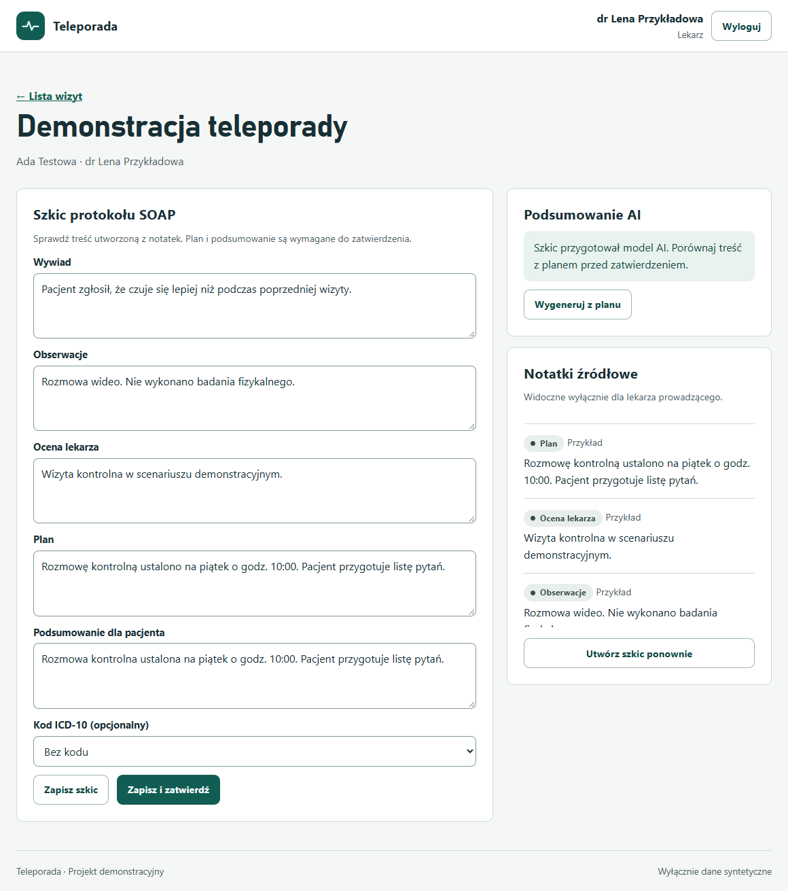

# Teleporada

Aplikacja demonstracyjna do rozmów wideo z lekarzem, dokumentowania wizyty w układzie SOAP i przygotowania podsumowania dla pacjenta z pomocą lokalnego modelu AI.

[Uruchomienie](#uruchomienie) · [Scenariusz demonstracyjny](#scenariusz-demonstracyjny) · [Dokumentacja i API](#dokumentacja-i-api) · [Testy](#testy)

- Lekarz otwiera pokój WebRTC i zapisuje notatki podczas wizyty.
- Po rozmowie aplikacja tworzy szkic protokołu. Qwen3 w Ollama może przygotować podsumowanie po polsku na podstawie sekcji **Plan**.
- Lekarz zatwierdza treść. Pacjent widzi podsumowanie i może zapisać je do PDF z okna wydruku. Lekarz może pobrać protokół jako demonstracyjny pakiet FHIR R5.

Projekt uczelniany przeznaczony do pracy na danych syntetycznych.

## Uruchomienie

Potrzebujesz **Node.js 22 w wersji co najmniej 22.13.0** oraz przeglądarki z dostępem do kamery i mikrofonu. Serwer korzysta z wbudowanych modułów Node.js, w tym SQLite.

```sh
git clone https://github.com/juzwuz/teleporada.git
cd teleporada/02_Aplikacja_kod
node server.mjs
```

Otwórz [localhost:3000](http://localhost:3000). Przy pierwszym starcie aplikacja utworzy lokalną bazę z kontami testowymi i wizytą kontrolną. W Windows możesz też uruchomić [Uruchom.cmd](03_Aplikacja_uruchom/Uruchom.cmd) z pobranej kopii projektu.

| Rola | Login | Hasło demonstracyjne |
| --- | --- | --- |
| Lekarz | `lekarz` | `DemoLekarz!2026` |
| Pacjent | `pacjent` | `DemoPacjent!2026` |
| Pacjent bez przypisanej wizyty | `pacjent2` | `DemoPacjent2!2026` |
| Operator audytu | `audyt` | `DemoAudyt!2026` |

### Podsumowanie AI

Uruchom lokalną usługę [Ollama](https://ollama.com/download) i pobierz model:

```sh
ollama pull qwen3:1.7b
```

Teleporada łączy się z Ollama na `127.0.0.1:11434`. Jeśli model jest niedostępny, w edytorze pozostaje szkic do ręcznej korekty. [Szczegóły konfiguracji](00_README.txt)

## Scenariusz demonstracyjny

1. Zaloguj lekarza i pacjenta w dwóch profilach przeglądarki lub w oknie zwykłym i prywatnym.
2. Jako lekarz wybierz wizytę kontrolną i otwórz pokój wideo. Jako pacjent odśwież status. Obie strony wybierają **Dołącz do rozmowy** i zezwalają na dostęp do kamery i mikrofonu.
3. Jako lekarz dodaj przykładowe notatki lub własny wpis testowy w sekcji **Plan**, a następnie kliknij **Zakończ wizytę**.
4. Porównaj podsumowanie z planem i wybierz **Zapisz i zatwierdź**. Pacjent odświeża widok, by odczytać zatwierdzoną wersję.

<details>
<summary>Zobacz edytor protokołu i podsumowania AI</summary>



</details>

## Dokumentacja i API

| Materiał | Zawartość |
| --- | --- |
| [Dokumentacja PDF](01_Dokumentacja/Dokumentacja%20projektu%20Teleporada.pdf) · [Word](01_Dokumentacja/Dokumentacja%20projektu%20Teleporada.docx) | Wymagania, architektura, model danych, widoki i wyniki weryfikacji |
| [Specyfikacja OpenAPI](02_Aplikacja_kod/openapi.json) | Zasoby HTTP, sygnalizacja, role i kody odpowiedzi |
| [Przykładowy pakiet FHIR](04_Dane_testowe/teleporada-demo.fhir.json) | Syntetyczny eksport zatwierdzonej wizyty |
| [Instrukcja uruchomienia](00_README.txt) | Pełny scenariusz, konfiguracja Ollama i wskazówki dla osobnych urządzeń |

## Testy

W katalogu `02_Aplikacja_kod` uruchom:

```sh
node --test
```

Testy używają osobnej bazy i testowej usługi modelu. Sprawdzają między innymi dostęp według ról, generowanie szkicu, reakcję na awarię modelu i strukturę eksportu FHIR.
